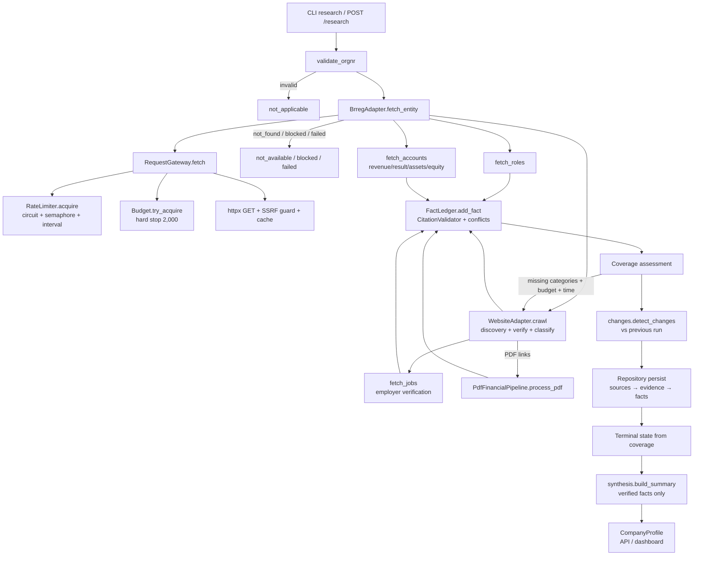

Internal-page identity guard (2026-10-18, D-076): after a successful focused website acquisition, `WebsiteAdapter.crawl` parses the retained-response text, passes full uncleaned visible text and `SourceRecord.final_url or url` to `EntityResolver.evaluate`, and handles a contradictory subject before `_soup_text` removes footer/script/style content or truncates extraction text. `_identity_text` preserves nearest-block and br/hr boundaries while joining inline spans; homepage verification uses it too. An unrelated customer-service heading cannot turn a separate foreign footer into a customer mention. Rejection retains the source capture and candidate rejection reason but emits no evidence/facts/family-found state for that page. Explicit same-block customer mentions retain the resolver's separate context treatment. Accepted pages follow existing extraction and production snapshot-support checks; this guard enables no website publication. Gateway robots/redirect/request/deadline behavior is unchanged; synchronous parsing/identity scanning still lacks a hard CPU bound. Tests: `test_website_page_identity.py` and adjacent resource/identity/publication cases.

## Homepage structured candidates — 2026-10-18

D-077: an accepted homepage reaches `WebsiteAdapter.crawl` → `organization_descriptions` over its decoded HTML soup before internal-link traversal. No new acquisition is issued. The restricted literal parser checks script/context/type/name/explicit Norwegian identifier, bounded JSON shape and valid Unicode description text. It returns exact values with script-index/JSON-pointer/identity-pointer diagnostics, plus inspectable rejections. Ordinary scripts, URLs, remote contexts and instruction-like text have no execution or network authority. Competing nodes are preserved.

The adapter emits separate candidate EvidenceRecord/Fact pairs using the source's actual retrieval time/hash. Description facts remain EXTRACTED and coverage remains unverified; arbitrary first400characters/meta descriptions no longer become candidates. Candidate diagnostic locations are stored in entity_match_details, not locator. `ResearchPipeline` → repository-backed `FactLedger` rejects them for missing typed support; normal atomic publication retains candidate observations/evidence/source bytes with the canonical result, while published facts and synthesis omit their descriptions. Existing1.1 export/verification remains applicable. Malformed/unsupported/oversized/invalid-Unicode descriptions abstain without preventing supported registry results. The parser does no retry/network/checkpoint work; existing gateway and company transaction/resume behavior applies. JSON limits are not hard HTML parsing deadlines. Tests: `test_website_structured_candidates.py`, including exact pointer replay, no-network references, adversarial Unicode production outcomes and offline bundle verification. Typed HTML publication, official anchor linkage, language identity and rights remain unimplemented.

# Current implementation record — 2026-10-16

Disabled model compatibility (2026-10-18,D-075): ordinary research uses deterministic adapters/ledger/synthesis and no longer constructs a model client. A direct legacy LLMClient.complete_schema call returns explicit disabled status for every key, URL, prompt, schema or retry argument; enabled is read-only false. It creates no session, does no acquisition/extraction and changes no budget, files or source policy. aclose has no resources to release. CostBudget.try_reserve raises unsupported status, while can_afford is advisory only; future paid calls require actual durable reservations/reconciliation. No retry/checkpoint/resume/model fallback path is implemented. CLI/API/batch continue the same canonical deterministic flow. Tests: test_model_policy.py actual base-class no-session/no-request/concurrency controls plus adjacent security/pipeline/budget/smoke checks. This does not establish working model integration or atomic paid accounting; older dormant-client descriptions below are superseded.

DNS cancellation (2026-10-18,D-074): RequestGateway.fetch establishes its acquisition timeout → _fetch checks persisted run origin and pure URL/domain policy → _validate_url_async waits for bounded _resolve_host_async → public-address validation. A daemon worker holds one of16process-wide OS-lookup slots until the OS call really finishes, including after caller cancellation. Capacity waits and futures remain cancellable; late results are discarded. Redirect and cached-hop checks use the same path. Before physical dispatch, _exchange reserves a request and resolves the final connection destination; cancelled DNS records a charged/unstarted reservation and cancels the unused rate permit. On success, private immutable host/address metadata reaches PinnedTransport, which rechecks it and sends to a numeric IP with original Host/SNI. No further hostname lookup occurs there. HTTP operations/health counts begin only after resolution; no source failure is inferred from locally cancelled DNS. Terminal timeout/checkpoint handling follows existing pipeline/runner rules; no storage migration or history rewrite. Tests: test_dns_deadlines.py plus transport/rate/smoke/deadline suites. DNS workers can linger until the OS returns but cannot delay process exit; parsing/storage/export hard bounds remain unfinished.

Resource-page classification (2026-10-18,D-073): WebsiteAdapter.crawl acquires and identity-checks permitted NEWS/CAREERS pages through the ordinary gateway → emits resources/news_page or resources/careers_page candidates with final-URL item keys → pipeline ledger requires snapshot-backed typed support → unsupported resource candidates remain FAILED/inspectable in persisted observations, with sources/evidence retained. A news URL/date elsewhere on an index adds no event coverage; a careers page alone adds no hiring coverage. Individual posting candidates keep the existing extractor, which is still production-withheld. No dated event or active vacancy is inferred. Canonical final coverage derives from supported facts/refresh; resources is not an added coverage family. Source request count, robots/retries/deadline, atomic publication/checkpoint/resume and historical outputs are unchanged. Tests: test_website_resources.py adapter/CAS and canonical pipeline checks.

Qualified monetary templates (2026-10-18,D-072): after final ledger/refresh processing, build_summary selects existing published financial slots → _financial_text checks explicit currency/unit/period/scope and a finite supported numeric value → Decimal fixed-point text with each metric's own qualifiers/reference. No rounding, scaling, currency default or common-year inference is performed. Missing qualifiers/unsupported representation or expansion over256digits withholds that fragment; supported siblings remain with an honest notice. ChangeRecord lacks old/new currency/units, so _change_text emits monetary observation kind/reference without values; full evidence remains inspectable. Rendering changes no acquisition/budget/status, retry, cancellation, checkpoint or storage rules, and frozen summaries remain unchanged. Production financial publication is still withheld. Tests: test_summary_financials.py template-only cases plus actual accounts/publication/result/evidence/history integration boundaries.

Mandatory robots policy (2026-10-18,D-071): Settings rejects RESPECT_ROBOTS=false. Public website/document calls enter RequestGateway.fetch → _fetch, which requires robots independently of the caller option → _robots_allows → generic gateway robots-file fetch. Run-origin/URL/DNS policy applies first; robots requests pass through ordinary request, deadline, redirect and snapshot accounting. A denial returns robots_denied without fetching content; registry APIs and the robots file itself retain their explicit exemption. Existing robots404/410 allow and403/error denial behavior is unchanged. Cache hits still require policy approval. No new retry, checkpoint, migration or resume behavior. Tests: test_robots_policy.py plus existing gateway/homepage/PDF/source-allowance suites.

Claim-referenced briefs (2026-10-18,D-070): `build_summary` selects existing published ledger values, appends their logical claim IDs and renders up to three parent/item-key-matched registered subunit observations. Keep each subunit's own identifier, physical address and recorded closed/deleted dates. Additional observations receive a notice; this is not a complete/active workplace count. The brief can resolve references through the same canonical facts/evidence graph. Change metadata supplies its recorded claim ID. Activity text does not acquire a recency claim from a heading. No citation grants publication authority, and unsupported producer families remain withheld. Existing snapshots/history are read unchanged; no networking/budget/checkpoint behavior changes. Tests: test_summary_references.py production captures, zero count, closure/display cap/foreign-parent guard plus explicitly preliminary legacy template cases.

Observation comparison in briefs (2026-10-18,D-069): pipeline passes `outcome.previous_run_id` from `apply_refresh` into `build_summary`. No earlier run plus published facts yields an initial-observation notice; no published facts yields no-verifiable-comparison notice. With an earlier run, CHANGED/RETRACTED records are described as changes in verified observations and NEW records separately as newly verified information. No-change text makes no assertion that the business was unchanged. Underlying change records and old canonical summaries remain untouched. No network, retry, budget, schema or storage migration is added. Tests: test_summary_changes.py actual first/identical/rename runs, empty ledger, NEW knowledge, outage-only and frozen-history controls.

Verification-aware unknowns (2026-10-18, D-068): after `_finalize_ledger` and `apply_refresh`, pipeline builds canonical unknowns through `synthesis.unknowns_for_coverage(Coverage(states=outcome.coverage))`, retaining refresh support/outage diagnostics and conflict notices. `build_summary` uses the same vocabulary and final coverage. Blocked, unresolved/conflicting, failed, inapplicable, not verified and no supported observation stay distinct; absent published facts cannot imply absent public accounts/jobs/events. Legacy API fallback calls the same helper with typed Coverage. All output is persisted through ordinary atomic publication; existing frozen summaries are read unchanged. Cancellation/partial finalization follows the same state construction, with no new requests/retries/budget use. Tests: test_summary_availability.py, financial/NAV/refresh/conflict/API/history boundaries.

## Observed smoke execution (2026-10-18, D-065)

D-067 public session handling: after URL/DNS validation, `PinnedTransport.handle_async_request` copies headers and removes Cookie before creating the numeric-destination request with original Host/TLS identity. Server-issued cookies are not replayed on later public acquisitions. This prevents HTTPX session state from violating the smoke credential guard; it does not enable an authenticated source. Cookie-dependent pages may stay unavailable. Test: test_public_acquisition_does_not_replay_server_session_cookies.

D-066 supersedes its source scope: `smoke.run_smoke` freezes a registry-only origin policy (`https://data.brreg.no`, or explicit deny-all). `BudgetManager` stores/restores it. `RequestGateway._fetch.validate_source` applies it before DNS/cache/robots/redirect work, alongside adapter restrictions. Exclusions are blocked with discovery time and no purported retrieval. Robots cache keys contain the run origins. Smoke mode/configuration state this limited scope; no company-domain/PDF retrieval or external coverage is claimed. Other interfaces' historical null policy means no run-level allowlist was declared, not that every source is approved. Tests: test_source_allowance.py, test_smoke.py and export/persistent/gateway boundaries. Prior exact1.1 bundle schemas replay through a narrow compatibility check; legacy-shaped result configurations cannot contain the new field.

Trigger: `smoke INPUT --live --output NEW_DIRECTORY` with explicit request/runtime/company/finalization limits and optional concurrency. `cli.smoke_command` validates configuration and calls `smoke.source_revision`; dirty/non-checkout installs fail before research. These limits are local experimental parameters, not confirmed competition allowances.

`smoke.run_smoke` exclusively creates the output directory, retains the exact input bytes, then uses the existing strict CSV/JSONL reader. Metadata cannot set identity or budgets. It overrides source endpoints/crawler limits, enables robots, disables model credentials/cost and opens a new `research.db`. `BudgetManager` → `BenchmarkHarness.evaluate_batch` → `BatchRunner.run_batch` → ordinary research/publication/checkpoint flow produces canonical envelopes and occurrence mapping. The ordinary identity, locator, snapshot and refresh safeguards apply.

During research, `TransportAudit` observes the actual asynchronous HTTPX transport below pinned DNS and compares its dispatch count with gateway telemetry. Failed dispatches count; cache hits do not. No header/query values are logged; authenticated/cookie-bearing operations are refused. This process-wide instrumentation is for a dedicated command process, not a concurrent API server. It is removed on error.

Finalization writes `transport.json`, `results.json`, `report.json`, then exports `evidence.zip` and verifies it offline. Only then does `manifest.json` record hashes, effective settings, HEAD, mapping cardinality, terminal counts, latency definitions, accounting agreement and observed budget adherence. Normal company failures still produce all envelopes. Failure/overrun exits1; invalid input exits2 unless a failure takes precedence. Unexpected export/integrity failure leaves the retained database/results without the outer completion manifest. Existing output directories are refused. No automatic retry starts a second allowance; ordinary database resume retains the original run budget, while rebuilding this particular smoke report after interruption is not implemented.

Tests: `test_smoke.py` uses production runner/storage/export with mocked HTTP transport; it also injects a hidden dispatch, verification failure and synchronous publication/export delays. No independent factual labels or official score are inferred. Example (local parameters): `smoke data/companies.jsonl --live --output data/smoke-new --max-requests 2000 --max-runtime-sec 900 --per-company-sec 30 --finalization-reserve-sec 20 --concurrency 4`. Generated content stays ignored and needs a rights review before sharing.

NAV policy state (2026-10-18, D-064): pipeline jobs stage always records the cheap local NavJobsAdapter.fetch_jobs result. The old anonymous search/name matcher is retired; the documented feed is not implemented. Return a source marked blocked with discovered_at only (no HTTP/hash/retrieval timestamp), no evidence/facts and nav_feed_not_implemented reason. No source/client/token request or request reservation occurs. Therefore depleted acquisition budget cannot fail a fictitious NAV request. Refresh maps job_board to jobs and preserves blocked/robots-denied/rate-limited state; summary/unknowns do not infer zero vacancies. Actual feed acquisition, employer.orgnr locators, active/inactive updates and privacy retention are deferred prerequisites, not a working feature. Tests: test_nav_policy.py and adaptive/rate/accounts boundaries. Historical NAV search descriptions below are superseded; no old user data was deleted or rewritten.

Accounts candidate qualification (2026-10-18, D-063): pipeline financial stage calls BrregAdapter.fetch_accounts through the gateway, retaining the response as before. Parse records, require exact target plus SELSKAP scope before chronology, require full valid ordered period dates, reject competing distinct newest records, and require explicit source currency. Missing qualifiers return ambiguous with source reason; malformed record containers return failed. Transport blocked/robots-denied/rate-limited states remain blocked,404/410 remain unavailable, and malformed200 stays failed. Qualified records retain a JSON-record pointer/raw display, full period/scope and original acquisition time; zero/negative values survive, but monetary units remain unresolved and facts start EXTRACTED. Ledger financial publication still fails closed. Pipeline adds per-account-source RefreshOutcome after ledger validation: unsupported candidates ambiguous, parser failure failed, access blocked distinct from absence/inapplicability. Coverage preserves state; retained source success is not evidence of available financial values. Discovered PDFs remain a separate bounded fallback for unresolved accounts. Tests: test_accounts_qualifiers.py, PDF/activity/outcome/refresh/safety suites. No source fetch replay, database migration or published monetary claim occurs. PDF/table/Decimal/scale/value-level support is not implemented by this flow.

Evidence inspection (2026-10-18, D-062): a View evidence button in a frozen company profile calls showEvidence(fact, runId), then GET /companies/{orgnr}/evidence/{evidence_id}?run_id=. API normalizes/checks the identifier, verifies company/run membership, loads only that immutable result and selects referenced evidence/source. Repository.read_capture verifies retained hash/length/representation; metadata comparison and CitationValidator check locator/value/subject support. Return nordtrace-evidence-view-v1 with source/evidence, referenced claim states and snapshot hash/representation/byte count. Invalid input422, unknown membership404, unavailable result/snapshot/support409; never network-refetch. The drawer displays actual source value/JSON pointer, basis, qualifiers and dates, with details separated. Escaped values and HTTP(S)-only source links prevent unsafe navigation/markup. Native buttons support Close/Escape; company/evidence sequencing fences late responses, winning profile render invalidates any old drawer, and trace loading/failure clears prior trace content; real browser operation remains unverified due tool startup failure. loadCompany now supplies the chosen run to company and trace requests, preserving old views after newer observations. Tests: test_evidence_view.py and optional Node built-in tests/frontend/evidence.test.cjs via test_frontend_script.py. Source bytes are read, not changed; no database migration, retry or acquisition allowance occurs. Legacy unsupported rows cannot gain verified evidence through this endpoint.

Adaptive website correction (2026-10-18, D-061): `pipeline website stage → WebsiteAdapter.crawl(identity, run_id)` runs once. The ignored skip_verified_domains argument and repeated adaptive_business call are removed; a missing supported business description remains unknown/unavailable. The later financial stage selects at most two real PDF candidates, checks financial applicability/publication/headroom, and only then applies its request gate before processing through the gateway and registers exact fetched sources before validation. No new candidate frontier/search/sitemap behavior is claimed. An exactly exhausted budget cannot fail a completed run when no eligible PDF exists; a real pending PDF still records a failed adaptive_financials stage. Cache avoidance of repeated HTTP is distinct from duplicate parsing/candidate extraction; this change claims no measured request/time/coverage gain. test_adaptive_work.py reproduces two real crawl invocations before correction; test_pdf_acquisition.py and outcome checks retain fallback and state behavior. Historical descriptions of a targeted second business pass below are superseded.

Registry response schema (2026-10-18, D-060): `ResearchPipeline → BrregAdapter.fetch_entity → gateway retained official response` keeps actual404 as not_found. A successful body must be an object with the exact requested checksummed identifier and a nonempty string navn before _parse_entity runs. Identifier disagreement has priority and returns ambiguous; missing/invalid name returns failed with an explicit source error, never a fabricated name or not_found. Canonical pipeline failure has registry_failed, failed identity coverage/refresh, captured200 metadata and no company/current claims. Existing failure finalization/last-known refresh rules apply. No new requests or schema dependency are introduced. Tests: test_registry_schema.py plus registry identity/authority and activity boundaries; malformed200 and actual404 remain distinguishable.

Activity provenance (2026-10-18, D-059): successful entity research supplies identity+entity SourceRecord to ActivityAdapter.extract_activity independently of accounts success. The adapter reads the exact hash-verified retained source_id via Repository.read_capture, compares capture metadata, validates the official entity endpoint/success and document subject, then extracts legacy candidates using the original acquisition time. It never reads accounts or mutable URL-cache content. Corrupt/missing/wrong-subject inputs fail explicitly; ordinary pipeline finalization preserves already supported partial identity and records failed outcome. No network/retry allowance is consumed by extraction. Candidate evidence has an exact JSON-root document locator/display with separately labelled generated interpretation; event/value support is unimplemented and candidate facts are withheld by the ledger; no recent event or capital change is newly published. test_activity_capture.py covers entity2024/accounts2099, accounts404, poisoned cache and capture failures. Typed dated events and event-specific refresh/expiry remain unfinished.

Eligible sample selection (2026-10-18, D-058): `sample-universe FILE.gz --output DIR --seed TEXT → sampling.sample_universe` refuses existing paths, verifies compressed hash under64MiB, streams capped strict JSONL to check uncompressed hash/unique valid IDs and count metadata strata/fixed hash partitions. It rejects invalid records/duplicates/hash mismatch/capacity or inadequate partition population before output. Seeded balanced quotas and a second streaming rank-heap pass select without replacement; both source hashes are rechecked before publication. Development and held-out membership is independent of requested sizes; sample100 stays inside its own sample1000. Unknown employees stay unknown, registry website metadata is not official ownership. Staged JSONL files include original metadata, while manifest records source hashes, physical lines, IDs, algorithm/seed, populations/quotas, missing strata and file hashes. Exclusively reserve destination, link data files then completion manifest last; close/remove only owned lock and clean verified staging. Concurrent/preexisting directories are preserved. An injected write failure leaves no completion manifest and may retain partial files for inspection; retry requires a new output path. No networking/research/model/database/retry allowance is used. Example: real public universe yields100 development and100 held-out inputs with38/41 strata each, explicitly unmeasured accuracy; benchmark consumes selected JSONL normally. Tests: test_sampling.py and CLI/input/benchmark/configuration suites. These selections do not count as researched profiles or independent reference labels.

Configuration verification (2026-10-18, D-057): process DATABASE_PATH still overrides the derived DATA_DIR/nordtrace.db path. `_env_file=None` disables dotenv loading, not process variables. The derivation unit now removes that one environment override; a separate positive test retains it and confirms precedence. Fresh installed commands can safely point to a disposable database without invalidating the derivation test. Production call chains/state/storage are unchanged; see test_configuration.py and docs/verification.md for the fresh-install failure/rerun evidence.

Operational benchmark (2026-10-18, D-056): `cli.benchmark --orgnr-file → input/report-path check → input hash → _read_batch_inputs → hash recheck` rejects malformed/changed input before Repository. Default uses every supplied occurrence; explicit --limit records first-N policy/excluded indices/source hash. `BenchmarkHarness.evaluate_batch → BatchRunner.run_batch → canonical get_results/get_run_inputs → batch_payload` checks complete exact correspondence. CitationValidator rechecks every current claim from retained captures; only passing claims contribute to supported metrics, and current supported legal_name is required for identity resolution. Registry claims cannot inflate external-source counts. Distinct claim_id counts separate logical claims from corroborating observations. Source records include historical inventory and never stand in for current transport telemetry. All terminal envelopes count as completed; availability/failure/unknown independent accuracy remain distinct. One runner budget covers acquisition; legacy fetch_live_companies refuses before networking. After source/cancellation/checkpoint handling inherited from runner, CLI atomically writes report and returns1 for support failure/budget overrun/research failure,2 for invalid inputs, otherwise0. Example: three occurrences including a duplicate invalid string can yield two complete envelopes, zero resolved entities and no measured recall. Snapshot tampering leaves execution history intact but removes support and makes the measurement fail. Tests: test_benchmark_contract.py plus CLI/input/result suites. Seeded population sampling is implemented separately in D-058; adjudicated accuracy remains unfinished.

Public starter projection (2026-10-18, D-055): after canonical rows pass support validation, `export_run → _starter_example` makes a second result pass, verifies the canonical digest has not changed and writes starter-example.jsonl. A manifest projection entry binds version/path/hash and declares acceptance unverified; earlier bundles without this optional member still verify. Claims retain qualifiers/references; registered website remains registered_website. Structured evidence exposes its pointer/raw value and labelled display text, with null claim_span. Only published current facts become claims; conflicts/last-known stay separate. Company availability remains the canonical six-state outcome; local lifecycle maps failed research to failed and other finished outcomes to completed. Company requests/cost stay unknown, referring to whole-run manifest accounting. `verify_bundle` reconstructs each projected row from canonical data and checks type-sensitive JSON equality/cardinality/hash without new acquisition. Missing/extra/mutated rows, including recomputed-hash zero-to-false edits, fail. Capacity, atomic completion, checkpoints/retries and errors remain D-054. Example: registry employee_count0 stays0 and a registered website is never labelled independently verified official_website. Tests: test_starter_projection.py plus export/input suites. Formal organizer schema/acceptance remains unavailable.

Portable audit export (2026-10-18): `batch --bundle` after research or `export-run RUN --output FILE.zip → core.export.export_run` reads ordered inputs/budget and one canonical result at a time. Every required result must exist; exact mapping, projected identity and CitationValidator retained support must pass. It writes results.jsonl, local schema and retained SHA-256 objects to a sibling temporary ZIP while checking uncompressed capacity. read_capture metadata must match successful result sources; failed/unrequested sources do not get invented captures. Whole-run telemetry/configuration, input mapping/counts, result/schema hashes and capture provenance go into the last member, manifest.json. Missing original accounting is null/unavailable. Flush/fsync precedes an exclusive hard link to the requested output, then only the owned temporary file is removed. Existing outputs/errors/incomplete runs leave no replacement artifact; SQLite checkpoints survive for retry. No acquisition/retry/model call occurs. `verify-bundle → _BundleReader → CitationValidator` checks bytes, locators/values, metadata, schema/operations and membership/cardinality without SQLite, extraction or URL access. Example: duplicate invalid JSONL records produce two mappings/one invalid-input envelope/zero requests and verify after DB closure. Local JSONL is not the starter flattened projection; hard output deadlines and organizer acceptance remain open. Tests: test_export_bundle.py plus snapshot/publication/result suites. D-054.

JSONL batch ingestion (2026-10-18): `cli.batch → _read_batch_inputs → json.loads` reads UTF-8/BOM records before opening Repository. Auto selects JSONL for .jsonl (case-insensitive), otherwise existing CSV/TXT; --input-format overrides selection. Blank physical lines are skipped. Strict object/string validation rejects malformed containers, non-finite constants and duplicate keys with the physical line number and no research/export. Identifier strings retain their supplied form in `map_inputs`, including empty/invalid strings; existing normalization, terminal envelopes and duplicate mapping apply. Other fields cannot become identity/configuration. `BatchRunner.run_batch` retains existing acquisition/budget/checkpoint/resume behavior. Malformed files never start a run. Output remains atomic whole-JSON canonical batches, not yet the starter's JSONL projection. Example: equal formatted orgnrs and equal invalid strings produce four mappings/two results, researching the valid entity once. Tests: test_jsonl_input.py plus CLI/input/cardinality checks. See D-053 and docs/evaluator-contract.md.

Structured persistence and freshness (2026-10-17): `build_result → Repository.publish_result → project_identity` now independently compares the company DTO with accepted identity observations before a new publication. A mismatch rolls back the result/checkpoint and all projections. `project_identity` computes last_verified_at from the newest valid aware retrieval instant among published target legal-entity identity facts; timezone offsets are compared chronologically. Unknown, naive or malformed dates do not use parsing time. `upsert_company` stores that same timestamp in the index. `RequestGateway.HTTP200 → SourceRecord → CachedResponse` shares one recorded acquisition time, which survives cache hits; retained content is not newly retrieved by parsing or writing. Run completion time remains separate. Existing frozen envelopes are not regenerated. Tests: test_publication_boundary.py plus atomic/projection/gateway/snapshot regressions. Example: January evidence parsed in October still records January identity verification, while completed_at records October. This does not implement conditional304 or full historical/cache policy labels. See D-052.

Expired task finalization (2026-10-17): `BatchRunner.run_batch → failure/save_if_missing → Repository.save_result` can now retire a foreign lease whose recorded TTL has expired when publishing an explicitly owned failed envelope. Lease retirement, immutable envelope and checkpoint share the same transaction; a later error restores the old lease with no result. No research coroutine or fresh allowance is required for depleted requests, expired deadline or unknown legacy budget. Live foreign owners, unowned callers and nonfailed publications remain refused. A later old worker is fenced by either the replacement owner token or the immutable terminal result. Concurrent failure finalizers can discover that another result won; typed ResultAlreadyPublishedError makes the runner read the existing canonical result rather than overwrite it or fail the whole resume. Other failures remain observable. Repeated resume reads existing results and preserves consumed budgets. Tests: test_crash_recovery.py, persistent budgets and execution deadlines. Example: crash after the only request reservation, lease expires, resume returns one request_budget_exhausted envelope with request_count1 and zero new research calls. Lease wall-clock/heartbeat and hard storage bounds remain limitations. See D-051.

Atomic publication (2026-10-17, supersedes D-047's early-row write): `research_company → _research_company → _finalize_ledger` now assembles sources/evidence/current/conflicting/all candidate observations in memory. `apply_refresh` compares prior canonical evidence and assembles changes without writing projections. The first current-company publication is `_persist_result → project_identity → build_result → Repository.publish_result`. Its single outer transaction calls save_result for ownership/immutability/checkpoint/history, revalidates retained support, and writes company/source/evidence/observation/change projections before commit. Nested selected bulk helpers do not commit independently. No network awaits occur while holding this transaction. A later write/support/ownership error rolls everything back, including a new envelope/checkpoint; an earlier profile/history remains unchanged. Separately committed captures, request reservations and traces remain for diagnosis. Existing source/evidence IDs must match their stored content; candidate subject/run/IDs and exact published projection must agree with the envelope. A blocked refresh with a prior company preserves its identity/verification time and atomically writes current failure sources/changes. Never-resolved inputs retain a complete canonical envelope without an invented FK identity. Cancellation uses the same partial-ledger publication and then propagates. Tests: test_atomic_publication.py, projection, refresh/history/replay, execution deadlines and conflicts/contracts. Example: an exception immediately after save_result or facts insertion leaves no new visible company/result/ledger rows, while captured bytes remain hash-verifiable. Schema6 is unchanged; legacy low-level APIs remain separately documented limitations. See D-050.

Budget lock recovery (2026-10-17): `BudgetManager → Repository._budget_transaction → BEGIN IMMEDIATE` now retries only busy/locked acquisition errors before entering the caller body. Individual SQLite waits are at most250ms, cumulative acquisition is at most one second on a monotonic clock and never extends the original supplied wall deadline. Retry backoff is bounded by both limits. A successful request reservation rechecks allowance/deadline under the lock and commits before transport; caller-body/commit errors roll back/propagate with no replay. Read-only and other noncontention errors fail immediately. Tests: test_budget_locking.py plus persistent-budget and execution-deadline suites. This solves transient lock acquisition, not hard disk/connect/commit or parsing/finalization bounds. See D-049.

Input preservation and schema dispatch (2026-10-17): `cli.batch → _read_csv` eagerly reads UTF-8/BOM comma-separated first-column records using strict CSV parsing before opening a repository. Only the first nonblank record can be a header, and only an exact case-insensitive orgnr/org_number/organisation_number/organization_number/organisasjonsnummer label. Later matching strings, org-prefixed invalid values and explicit empty cells pass through `map_inputs → BatchRunner` to ordered input mapping and terminal invalid envelopes; physical blank lines are separators. Duplicate keys share an envelope but retain every index. Malformed CSV/encoding returns a Click error with no research or partial export; empty files retain exit2. `cli.validate → validate_result` rejects non-object JSON and explicit unsupported schema versions; only missing-version legacy input uses shallow historical checks, while version1.1 uses CompanyProfile validation. Neither path independently rechecks stored snapshot support. Tests: test_input_validation.py plus CLI/contract checks. Example: orgnr header followed by orgbad, orgnr, explicit empty and orgbad yields four mappings/three invalid envelopes/zero requests. See D-048.

Structured company publication (2026-10-17): `fetch_entity → identity_claims → FactLedger → project_identity(identity, conflicts, published_facts) → upsert_company` now writes only supported identity business fields, including the initial row before subsequent adapter awaits. The acquisition DTO remains available locally for discovery. During finalization, `_persist_result → project_identity → build_result → save_result` uses accepted claim values and clears unbacked fields with unresolved markers; repeated projection is idempotent. A supported employee count0 remains0. Capital/share counts, group flags and other unconverted predicates remain unknown until they have typed supporting locators. Synthesis reads legal name from the ledger; rejected name drift never appears as a company assertion. Existing frozen history is not regenerated. Errors/cancellation still finalize the supported partial ledger using the same projection. Tests: test_identity_projection.py and conflict/contract regressions; example: raw kapital.belop=true remains retained but cannot appear as share_capital1.0. See D-047.

Registry authority correction (2026-10-17): `BrregAdapter.fetch_entity → require_registry_identity_acquisition` now verifies source canonical/requested/final URLs and every redirect before accepting a successful identity or interpreting404 as authoritative absence. Only official HTTPS data.brreg.no on default443 with the exact target /enhetsregisteret/api/enheter/ORGNR endpoint qualifies. Credentials, fragments, unsupported query parameters, controls, foreign ports/hosts and mismatched entity paths abstain. A configured mirror200 or404 returns ambiguous with the actual attempted source; it cannot populate structured company identity or establish nonregistration. Early identity failures also emit their actual per-family RefreshOutcome, so mirror ambiguity is preserved instead of inferred as not_available from HTTP status. Safe transport remains independently enforced by the gateway.

`FactLedger → verify_snapshot_support` repeats this origin/endpoint rule against the retained capture before value publication. It does not trust a self-declared registry type/tier, matching name or orgnr alone. Subunit support now also checks canonical URL, every redirect and credentials in addition to the existing endpoint/parent filter; blank duplicate parent filters cannot disappear through query parsing. Official routing with explicit443 remains accepted. Supplied official snapshots need their own versioned anchor adapter, still unfinished; an arbitrary mirror is not promoted as that adapter. Tests: test_registry_authority.py, test_registered_subunits.py and existing identity/locator/refresh tests. All new fixtures are synthetic; no live source was called.

Terminal outcome correction (2026-10-17): successful `_research_company` completion now follows the actual exact-registry resolution and acquisition path. Identity-only success is available even when external family coverage is empty. Registry deletion remains the company's legal status; it does not invent an evaluator eligibility rule or make historical research inapplicable. Conflicting supported observations remain ambiguous. Source-family unavailable/blocked/failed states remain separate from company-level execution and coverage; available does not mean complete population coverage.

`acquisition_allowed` records skipped pipeline work. Website discovery/internal-page headroom skips now return explicit acquisition_budget_limited diagnostics, propagated through initial and adaptive calls. The existing six/four-request thresholds are unchanged pending scheduler evaluation. Skipped work returns failed with request_budget_exhausted, deadline_exceeded or acquisition_budget_limited as applicable, retaining its supported partial ledger. Direct pipeline request/deadline gates retain typed reasons rather than becoming generic registry/research failures.

`build_result → CompanyProfile.status_reason → Repository.save_result` serializes the explicit outcome/error reason once. Frozen CLI/API/batch views expose that same reason. This is an additive optional field in the local1.1 adapter; pre-existing envelopes without a recorded reason read as unknown/null, with no inferred historical reason or rewrite. Tests: test_outcome_semantics.py covers identity-only/deleted completion, all six states, real HTTP historical/API/export consistency, legacy unknown reasons, pipeline and adapter budget skips, and direct depleted/expired execution. These fixtures do not measure external recall or organizer acceptance.

Cancellation and acquisition cutoffs (2026-10-17): `BatchRunner.run_batch → one → acquire → ResearchPipeline.research_company → _research_company` now bounds cooperative acquisition by the smaller of the per-company setting and remaining run work time. `BudgetManager.work_time_remaining` subtracts the explicit `FINALIZATION_RESERVE_SEC` from remaining runtime; the default is0 for compatibility, and configuration rejects a reserve greater than or equal to total runtime. The historical `PER_COMPANY_SOFT_DEADLINE_SEC` name remains accepted but now cancels acquisition instead of merely logging an overrun. All gateway waits/transport gates also use the acquisition cutoff. The frozen configuration restores the same reserve on resume. An example local run uses MAX_RUNTIME_SEC=60, PER_COMPANY_SOFT_DEADLINE_SEC=5 and FINALIZATION_RESERVE_SEC=10; those are local parameters, not organizer limits.

Pipeline cancellation sets a specific deadline/cancellation error and finalizes its real ledger, refresh metadata and summary before persisting the partial canonical result. Supported snapshots/claims remain inspectable; cancellation never promotes candidates. `research_company` distinguishes its actual timeout context from a provider's ordinary TimeoutError. Task cancellation propagates after persistence; timer expiry returns the saved failed outcome. If interruption cleanup cannot write, it logs the storage error and preserves external cancellation rather than inventing a saved result. Runner-only fallback creates complete failed envelopes when no production result exists. Queued inputs that never start are finalized without acquisition, and invalid inputs retain not_applicable. Legacy terminal checkpoints with no canonical envelope receive legacy_result_unavailable rather than an invented successful profile, even when their original budget is unknown.

Every worker releases its lease in finally. On cancellation or orchestration failure, the runner cancels and drains its child tasks before finalizing queued results or closing the pipeline; storage failure cannot skip transport cleanup. `Repository.save_result(owner=...)` checks company_claims in the same publication transaction. A follower cannot publish a failure for a foreign-owned task. Cancelling such a follower leaves the run explicitly incomplete (no completed_at) until the owner publishes; it cannot export a complete batch from missing envelopes. This is deliberate concurrency semantics, not an omitted completed result. Crash lease expiry and generation fencing still need separate work.

Finalization uses synchronous storage after acquisition stops. The reserve makes time available but does not establish a hard end-to-end wall-clock bound: synchronous DNS, parsing, serialization and disk stalls remain unfinished. SQLite budget lock wait is now bounded to250ms or the remaining absolute deadline, whichever is smaller, after a four-connection Windows contention failure at50ms. Tests: test_execution_deadlines.py covers slow acquisition, queued inputs, direct pipeline partial support, external cancellation, reserve validation, legacy outcomes, provider error classification, competing follower cancellation and injected storage/checkpoint failures. No live acquisition was used for this unit.

Durable allowance flow (2026-10-17): new `BatchRunner.run_batch` creates the run/input mapping, then `BudgetManager.bind_run(initialize=True)` freezes version1 RunBudgetState in the existing runs.budget_json field. API research/batch stores this state before launching its background worker. The authoritative configuration includes request/runtime/cost caps and per-company setting; finalization reserve was explicitly0 at this checkpoint; the later cancellation record above adds explicit configuration. Resuming restores the original configuration, absolute Unix deadline, elapsed floor, consumed requests and recorded cost; new process defaults cannot enlarge the allowance. Unknown legacy original limits yield complete pending-company failures with run_budget_unavailable and no new acquisition. Known usage is retained and unknown limits serialize null, not guessed defaults.

Every bound gateway attempt goes through `PersistentRequestBudget.try_acquire → Repository.reserve_run_requests`, using a bounded SQLite write transaction before transport. Cross-process reservations see the same runs.request_count; stale checkpoints use MAX rather than lowering consumed counters. Committed elapsed exhaustion also fences already-bound workers. Transport outcome/retry/domain/stage/company counters persist separately. A request reservation can remain charged after interruption; telemetry distinguishes completed HTTP operations, known unstarted reservations and unresolved reservations. No uncertain reservation is automatically refunded.

The gateway rechecks the monotonic deadline after reservation/client preparation and immediately before HTTP, since a slow durable commit can consume the allowance. Local cancellation before HTTP releases its rate permit without recording source failure. An inner finally releases every permit even if durable telemetry raises, preventing storage contention from starving later requests. Tests inject a SQLite writer and a delayed commit while independently counting actual mock HTTP operations. CLI research/batch/resume share failure exit logic; repeating resume on a terminal failure remains nonzero. Invalid inputs still get not_applicable even with zero request allowance.

This update establishes durable request limits/restored deadlines for CLI/API/batch. Low-level standalone gateways/pipelines with unbound budgets retain explicit in-memory semantics; callers must bind a run for durable resume. Atomic model cost reservations/retry billing, cross-process cost aggregation, synchronous execution/output bounds, atomic cost reservations and complete atomic publication remain unfinished (cooperative cancellation and explicit time reserve were added in the later record above). No new paid API or credentials were used. Tests: test_persistent_budgets.py, result contracts, gateway/rate tests and synthetic100/1000 input cardinality.

Registered subunit flow (2026-10-17): after exact parent identity, `_research_company → BrregAdapter.fetch_underenheter` constructs bounded zero-based pages at the configured registry origin using overordnetEnhet and stable orgnr sort. Request/time/rate/redirect gates apply to every page; downloaded next links are never executed. Requested page size is a hard record bound, checked before record processing; metadata cannot enlarge it. BRREG_BRANCH_PAGE_SIZE defaults20 (local maximum100) and BRREG_BRANCH_MAX_PAGES defaults10; these are acquisition bounds, not organizer budgets. Pagination number/size/totals must be consistent; changing counts, invalid metadata, duplicate/rejected records, failed pages and exhausted limits leave an explicit partial collection. Earlier supported records remain available.

Each subunit record must supply distinct checksum-valid unit and parent IDs; the actual overordnetEnhet must equal the target. No target municipality or ID is copied into evidence to manufacture attachment. Physical locations use beliggenhetsadresse, with postal fields kept distinct; missing physical data stays unknown. brreg-subunit-v1 normalizes supported attributes, including explicit closure/deletion dates without inventing active/closed status. The parent has a registered subunit relationship; a subunit is not assumed to be an independent legal entity or an actively operating workplace.

`FactLedger → verify_snapshot_support` verifies official HTTPS/default443 origin, exact collection endpoint/parent filter, raw record pointer, normalized value, legal-entity relationship scope and stable unit item key. Every page source is registered before its evidence/claims. Canonical references resolve to exact retained bytes, and per-page availability is separate from overall scan completeness. Successful first-page claims survive later403; source state remains available while collection completeness is partial. A complete empty collection is explicitly unavailable information, not a transport failure. Refresh still never infers disappearance solely from an absent item. Tests: test_registered_subunits.py plus registry/gateway adversaries.

Registry origin refinement (2026-10-17): gateway allowed_origins binds scheme, exact hostname and effective port before DNS/transport. Brreg initial/redirect/cache calls declare the configured origin. Nested robots and their cache inherit the same constraint. A redirect to a different port cannot borrow registry authority; branch publication independently requires the official default443 origin. Tests cover an alternate-port response, fresh/cached robots and response-size metadata exceeding the configured record bound. This extends the earlier hostname/scheme policy.

Refresh semantics update (2026-10-17, supersedes earlier unresolved-outage records): every research completion, including early registry failure, calls `core.refresh.apply_refresh` from `_research_company` finalization. `Repository.previous_result` selects a frozen predecessor published before current run creation; prior facts and last-known observations must pass the current snapshot/locator validator again. Legacy relational PUBLISHED labels alone are insufficient. `detect_changes` compares supported current observations by stable claim identity. Missing observations become SOURCE_UNAVAILABLE, never automatic RETRACTED. A successful HTTP response does not prove complete extraction, pagination or removal. No producer currently supplies verified affirmative removal evidence; vacancy expiry, branch removal and proven retractions remain unimplemented.

The canonical envelope separates current facts, conflicts and last_known. Last-known copies retain their original observation/run/source/evidence IDs, value and verification timestamp, and carry SOURCE_UNAVAILABLE status. Their captured sources/evidence are retained in the new envelope; they are not inserted as newly verified facts or counted as current coverage. Summaries explicitly identify their unconfirmed state. Changes reference old/new observation and evidence IDs; periods remain separate, so a new year cannot remove the previous period. Per-source refresh_outcomes record family, availability and reason, with completeness unknown unless a future producer establishes it. 404/410 means source unavailable, not fact removal. No conditional revalidation or automatic conflict resolution is claimed.

Schema 6 adds history_order after backup. Run creation and first canonical publication each receive an increasing sequence in their own transaction. The predecessor must precede the run-creation barrier, including equal second-resolution timestamps; a concurrently published result is excluded. No old sequence is fabricated: legacy predecessors require a known completed_at strictly before current start. Missing legacy timing abstains. Existing payloads remain unchanged. `GET /companies/{orgnr}?run_id=...` now forwards the historical selector to the immutable canonical reader; unavailable legacy history returns 409. Tests: test_refresh_safety.py (blocked/404/invalid JSON/partial field then recovery, true historical HTTP view, cutoff/order) and test_refresh_history.py (schema5 copy/backup and unsupported history rejection).

Failure finalization (2026-10-17): `_research_company` finalizes the ledger in finally, retaining supported facts, conflicts, evidence, sources and family availability when a later adapter raises. The terminal execution remains failed; known disagreements cannot disappear and expose a first-winner identity. Source/evidence/fact persistence is still sequential, not a complete atomic-publication transaction. The injected accounts-parser failure test checks canonical/API/current-row withholding after two real simulated registry acquisitions.

Conflict publication update (2026-10-17): `FactLedger._detect_conflict` moves every competing observation of a logical claim to CONFLICT. Corroborating one side does not silently resolve disagreement. Pipeline coverage marks affected families ambiguous; canonical envelopes retain conflict observations, evidence and snapshots separately from published facts. `contracts.project_identity` clears disputed structured identity fields, including address/status dependencies, before canonical serialization and final current-row persistence. An unresolved legal name is an empty legacy-required string with explicit unresolved_fields; the orgnr remains available. Acquisition identity is not mutated. Summaries withhold disputed names/industry and use typed Fact attributes rather than parsing the new JSON claim key. Tests: test_conflict_publication.py, real simulated gateway/SQLite/API path. Automatic conflict resolution, source-complete refresh and unsupported legacy views remain unfinished.

Logical claim/observation update (2026-10-17): `Fact.fact_key` serializes the tuple (orgnr, category, field, reporting period, source item key, subject scope) as escaped canonical JSON, avoiding delimiter/Unicode replacement collisions. `claim_id` is its versioned SHA-256 identity; values, confidence, URLs and random observation IDs are not the key unless a source object's URL is its explicit item key. `fact_id` remains the existing historical observation primary key and is also exposed as observation_id. Each new run can retain a new observation of the same claim. Identical claim/value/qualifiers from the same snapshot within one ledger coalesce; a separate repeated candidate has internal DUPLICATE state, while re-adding the retained object leaves it PUBLISHED. New identity fields have explicit legal_entity scope and no collection item key. Vacancy candidates carry source posting ID/URL; branch candidates carry subunit orgnr as item key for the parent's relationship assertion. Missing vacancy/branch item keys abstain. These candidate keys do not establish that their still-unconverted external evidence can publish.

Schema 5 adds item/scope columns and full change JSON after backup. Old observations retain their IDs and unknown scope; no missing item identifier or support is fabricated. Repository previous-observation selection groups by the complete key, preserving sibling collection items. Changes take field/period/item/scope from actual facts, never split a delimiter string. Diff/conflict comparisons use the actual assertion plus currency, unit and validity; shortened normalized labels cannot hide changed dates/operands, and monetary numeric comparison uses exact Decimal equality. Current-source failure/removal and conflict-winner semantics remain unfinished. Production identical-byte replay is tested across two runs with stable logical IDs, distinct observation IDs, one retained blob and only UNCHANGED records. Copied schema-4 migration, collection persistence and qualifier regressions are in test_claim_identity.py. A read-only copy of the existing schema-1 user database was upgraded to schema 5; all original column/row fingerprints across ten tables matched and foreign keys passed. The original database was not migrated by that check; manifest/copy remain ignored under data/.

Registry authority policy (2026-10-17): every Brreg acquisition declares its configured hostname and scheme to the gateway. Initial requests, cached redirect chains and every live hop must satisfy that policy. A registry response cannot redirect to an unrelated public host or downgrade HTTPS to HTTP and keep registry authority, even if its JSON copies the target orgnr. Rejections occur before connecting to that destination. Tests: two instrumented redirect cases in test_registry_identity.py, plus gateway transport regressions.

Nested robots acquisition inherits allowed host/scheme policy. Robots caches are keyed by origin and those policy constraints, so rules fetched through a permissive redirect cannot satisfy a later stricter source policy. Fresh and pre-populated HTTP/robots caches both reject HTTPS downgrade before a prohibited connection. Independent mock transport operations equal budget deltas in test_gateway_transport.py.

Publication support update (2026-10-17): production `ResearchPipeline → FactLedger(repository) → CitationValidator → verify_snapshot_support` now requires retained hash-verified bytes and a typed locator. Missing or unsupported locator formats are withheld, regardless of model/adapter verdict, confidence or snippet. Registry identity uses `BrregAdapter.identity_claims` to emit one JSON-pointer evidence record per atomic field. The verifier resolves RFC 6901 pointers, compares exact typed raw values, binds each predicate to documented Brreg paths and an allowlisted normalization, checks document orgnr, and compares normalized claim values. Structured evidence displays a JSON field value, not an invented verbatim quote. Address joining, website normalization and status derivation have versioned normalization IDs. Employee counts require nonnegative integers excluding booleans; invalid counts remain unknown even in the identity object. Missing status/group flags remain unknown; forced liquidation is distinct. Acquisition metadata, evidence/fact retrieval timestamps and authority must match the capture. Schema 4 backs up old databases and adds nullable locator JSON plus full source JSON; historical records are preserved with no invented locators. Current identity claims round-trip through SQLite and canonical API with their support intact.

This fail-closed gate temporarily withholds all non-identity producer candidates until their locators and predicate rules are converted. Existing roles, website, activity and financial extraction still run but cannot publish through the production ledger merely by supplying text. In-memory legacy ledger tests without a repository exercise only the earlier preliminary gate; they are not production support proof. Conversion of external families, full extraction replay, source-specific retention, refresh parser-regression handling and release coverage measurements remain required. No live smoke test should be used to claim restored external coverage at this point. Tests: `test_evidence_locators.py` (adversarial values/pointers/subjects/types/provenance, true zero, actual production pipeline, SQLite/API round-trip and copied schema-3 migration).

PDF acquisition update (2026-10-17): `WebsiteAdapter._extract_links` routes document paths (including queries/fragments) to PDF candidates, excluding them from HTML extraction. `crawl` records acquisition state discovered, discovery time and referring source ID; retrieval time/status/hash remain absent until a gateway request succeeds. The adaptive pipeline attempts permitted document fallback when no financial claim was accepted and accounts were missing, unavailable, blocked, ambiguous or failed; explicit not_applicable skips it. Time/request gates still apply. `process_pdf`'s returned acquisition source enters the ledger before evidence/claims; retained bytes resolve by that exact source ID. Financial coverage only advances for published candidates, not extracted count. Tests in test_pdf_acquisition.py verify real gateway/orchestration and stub only PDF extraction, so they establish acquisition/registration rather than PDF financial correctness. The current table parser remains unsafe and its candidates remain subject to the preliminary rejection gate.

Snapshot acquisition/replay update (2026-10-17): `ResearchPipeline.__init__` passes its repository to `RequestGateway`. Every successful HTTP body, including robots and cache hits, calls `_retain → asyncio.to_thread(Repository.save_capture)` before the successful source is returned. Schema 3 adds content-addressed `snapshot_blobs` and immutable `source_captures` acquisition metadata without company foreign keys, so unresolved identities also retain their evidence. Existing databases receive a SQLite backup before additive migration; old truncated text records remain legacy and are never promoted as verified captures. The declared `http-response-body-v1` representation is the complete body after HTTP transfer framing, with content encoding required to be identity. SHA-256 hashes those bytes rather than decoded text. Cached content retains its original retrieval time; requested/final URLs, redirect chain, HTTP status, content type and company request context are captured separately from identity verdicts.

Capture persistence uses a dedicated SQLite connection with at most 50ms or remaining deadline of lock wait, checks the absolute deadline around the transaction and closes/rolls back on failure. Database contention produces failed/timeout acquisition, never a late success. Disk/CPU scheduling is not a real-time OS guarantee. `Repository.read_capture(source_id)` verifies blob length/hash, metadata hash and representation; missing/tampered content raises rather than refetching. `RequestGateway.load_capture` reconstructs the original cached body/text offline without changing observation time or spending requests. CLI `replay-source SOURCE_ID --output data/source.bin` atomically exports verified bytes; `verify-snapshots RUN_ID` checks successful sources referenced by persisted envelopes and exits 1 on missing/invalid captures. Neither command proves claim support or reruns extraction. Test examples: binary PDF, 210kB Latin-1 body, cache reuse, production pipeline with simulated registry, schema-2 copy upgrade, CLI tamper refusal and SQLite contention in `tests/unit/test_snapshots.py`. Exact evidence locators, source-specific retention policy and full extraction replay remain outstanding; PDF discovery labels were corrected in the subsequent acquisition update above.

Registry anchor update (2026-10-17): `BrregAdapter.fetch_entity` checks the returned organisasjonsnummer against normalized requested identity before calling _parse_entity or creating evidence. A missing/invalid/different identifier abstains as ambiguous; canonical output preserves the HTTP source, entity_ambiguous error and zero claims. Matching IDs retain the returned legal name. Tests: `test_registry_identity.py`. Supplied official snapshot input is still unimplemented.

Unavailable identity diagnostics (2026-10-17): the identity early-return path retains the attempted registry SourceRecord even without a company row. It distinguishes entity_not_found (404), registry_blocked and registry_failed in canonical errors. The installed CLI adapter's three invalid occurrences preserve mapping to two complete terminal envelopes and exit 2. Contract tests exercise 100/1,000 distinct invalid inputs with explicit zero requests/API cost; these are synthetic cardinality checks, not live researched profiles. Clean-install validation is recorded at code commit e64c0ee in docs/verification.md.

Runtime update (2026-10-17): Settings reads working-directory .env, defaults data/ there and derives DATA_DIR/nordtrace.db unless DATABASE_PATH overrides it. This also applies to installed wheels. Missing homepage/internal-page bodies become failed sources/rejections and preserve independent work. Package builds include dashboard HTML/licences; local CI configuration invokes frozen install, pytest, Ruff, mypy/build/resource checks. Compose uses the actual API module and loopback host binding; daemon execution is blocked. The optional LLM helper has no production extraction/synthesis callers.

`FactLedger.add_fact → CitationValidator.validate` now rejects disagreement between claim/evidence identity verdicts, wrong-company sources and mismatched supplied hashes. Financial candidates must include currency, reporting period/year and a finite exact numeric value represented in the evidence text, with grouping/sign preserved. Filing notices without a value are withheld. These are preliminary rejection conditions; predicate/table semantics and snapshot-backed locators are not implemented. Consequently current Brreg filing-only financial evidence is withheld until its producer is repaired. Tests: `test_publication_safety.py` plus ledger/category tests. No complete financial-verification claim is made.

Transport now follows `RequestGateway.fetch → absolute asyncio timeout → _fetch → validate_url / robots → _exchange → rate token → atomic request reservation → client.stream → PinnedTransport → per-original-origin HTTP transport`. Each redirect re-enters URL/robots checks and consumes its own operation; retries obey the destination policy. Bodies accumulate only within the cap, with unsolicited compressed representations rejected before decoding. Pinned addresses retain original Host/TLS SNI and separate hostname pools. Cancellation closes the response and releases the rate token. Robots fetches use fetch with robots recursion disabled; 404/410 allow, successful rules govern, all other outcomes deny. Cached sources declare cache_hit and original retrieval time. Source chains and final URLs are serialized with envelopes. Synchronous DNS and non-transport parsing/batch finalization are still not hard-bounded; optional model transport is separate and unfinished. Tests: `test_gateway_transport.py`.

Identity input now calls `validate_orgnr → normalize_orgnr` on the entire supplied value, supporting grouped digits and NO/MVA labels while retaining checksum validation. `EntityResolver.evaluate → subject_orgnrs` separates labelled document-subject identifiers from incidental numbers and explicit customer/supplier mentions. Homepage attachment calls the resolver before positive tests and requires a matching labelled ID or exact legal name/address. `WebsiteAdapter.crawl` captures footer-inclusive identity text before body cleaning and passes a hostname to the offline PSL parser. Rejected operator contradictions stay inspectable; complex relationship scopes remain unverified. Tests: `test_identity_boundaries.py`, `test_entity_matching.py`, `test_orgnr.py`.

RateLimiter.acquire now rechecks the monotonic spacing deadline after every timer wakeup. The runner's synthetic 100-company/deadline/resume fixtures explicitly supply their fake pipeline and run offline; the at-37 scenario finalizes deadline-exhausted companies and proves no repeat work, not crash recovery. Tests: `test_spacing_rechecks_monotonic_deadline_after_early_timer_wakeup` and the three non-live checks in `test_contamination_scale.py`.

This record supersedes conflicting interface/persistence descriptions below. The earlier detailed audit remains historical context; snapshot acquisition, hard transport deadlines and safe refresh are still tracked as unfinished in `docs/implementation-tracker.md`.

Single research now calls `cli.research → BatchRunner.run_batch → ResearchPipeline.research_company → _research_company → build_result → Repository.save_result`. Input mapping normalizes valid IDs, preserves invalid input strings and deduplicates work by result key. The pipeline executes the existing adapters and ledger; its wrapper serializes the actual terminal outcome and synthesis. Invalid, unregistered and failed outcomes can be stored without a company identity row. A result contains explicit source/evidence records and machine-readable errors; snapshot/locator validity is a separate unfinished publication requirement.

`Repository.save_result` validates and inserts the envelope and updates the run's terminal checkpoint in one SQLite transaction. Completed envelopes are immutable: identical retries are accepted; differing payloads for the same run/company raise an error. Repeated pipeline calls return the retained outcome. Migration version 1 adds company_results/run_inputs; version 2 adds company_claims leases. Prior tables are preserved. Existing older databases are first backed up through SQLite's backup API to a uniquely named sibling `.pre-vN-*.bak`; opening a current database does not back it up again. No historical envelope is invented for old rows. Run updates and error finalizers reconcile states against committed envelopes, including concurrent publication from other connections.

Batch follows the same pipeline, catches a company's execution exception as an explicit failed outcome, and continues unrelated companies. Ordered `run_inputs` preserves duplicate and invalid occurrences; one envelope is produced per unique normalized company or distinct invalid input. This duplicate policy is a local adapter convention pending organizer confirmation. CLI export validates cardinality and uses a flushed temporary sibling file plus atomic replacement. SQLite checkpoints are incremental; streaming JSONL export and an external completion manifest remain unfinished.

Resume schedules only `pending` companies from the existing run; it refuses new companies. An atomic SQLite lease prevents concurrent runners from owning the same company task; competing runners wait for the published result. Leases expire after the remaining run allowance plus 60 seconds; crash recovery, budget restoration and hard cancellation/finalization remain unfinished. The old run-state count is never a substitute for a missing immutable envelope.

API research returns the persisted canonical result even when identity lookup failed. API batch runs the same run ID it returns, retaining invalid inputs. `_company_payload` returns the immutable requested or latest envelope, including synthesis. Requested historical views without an envelope return 409. Current legacy rows remain readable under `schema_version=legacy-unfrozen`; they cannot claim frozen history.

Verification: `tests/unit/test_result_contract.py` covers dropped invalid inputs, actual resume calls, isolated failures, frozen identity/summary, no-identity persistence, API run-ID tracking, legacy backup preservation and dangling references. `tests/unit/test_api.py` uses a real gateway with a 404 transport fixture. Real PDF tests are live-marked and default pytest execution excludes live tests. Example: `python -m nordtrace.cli batch companies.csv --output data/results.json`; invalid inputs remain in the output and cause exit 2, research failures cause exit 1, and non-error availability outcomes return 0.

# Execution Flow — NordTrace

The ACTUAL end-to-end execution flow, documented from the code (not assumed).
Function/module relationships include nested calls where they are meaningful.

---

## Entry points

Two entry points produce identical research runs:

1. **CLI**: `python -m nordtrace.cli research <orgnr>` → `cli.research()`
   (`cli.py`) creates a `ResearchRun`, instantiates
   `BudgetManager` + `Repository` + `ResearchPipeline`, and awaits
   `pipeline.research_company()` on a fresh event loop.
2. **API**: `POST /research` → `api.app.start_research()` validates the
   orgnr (422 on invalid), creates a `ResearchRun`, and schedules
   `_run_research_blocking()` on a worker thread (so the API stays
   responsive); the dashboard polls `GET /research/{run_id}` until
   `state == completed`.

Batch/resume: `cli.batch()` / `cli.resume()` →
`engine.runner.BatchRunner.run_batch()` — bounded-async execution
(`asyncio.Semaphore(concurrency)`), checkpointing run state to SQLite after
every company, skipping companies that already have a terminal state.

---

## Real stage order (from `engine/pipeline.py::research_company`)

```
 0. validate orgnr format        core/orgnr.validate_orgnr()          → not_applicable on invalid
 1. canonical identity           adapters/brreg.fetch_entity()        → not_found/blocked/failed terminal on miss
 2. roles (leadership)           adapters/brreg.fetch_roles()
 3. financials (registry)        adapters/brreg.fetch_accounts()
 4. website discovery + crawl    adapters/website.crawl()
 5. jobs (NAV)                   adapters/nav_jobs.fetch_jobs()
 5b. adaptive top-ups            coverage assessment → targeted business/PDF research
 6. activity (registry signals)  adapters/activity.extract_activity()
 7. change detection             core/changes.detect_changes()
 8. persist ledger               repository (sources → evidence → facts)
 9. terminal state               from coverage matrix
10. synthesis                    core/synthesis.build_summary()
```

---

## Function-level flow

### Stage 1 — Canonical identity (`adapters/brreg.py`)

```
pipeline.research_company(orgnr, run_id)
  → brreg.fetch_entity(orgnr, run_id)
      → gateway.fetch(url, stage="identity", company=orgnr, ...)
          → rate_limiter.acquire(domain)        # circuit check + semaphore + min-interval
          → budget.requests.try_acquire(1)      # hard stop (BudgetExceededError at limit)
          → validate_url(url)                   # SSRF guard (before everything)
          → robots check (for crawlers)
          → cache freshness check               # CachedResponse within TTL
          → httpx.AsyncClient.get()             # the only outbound HTTP
          → budget.requests.record_outcome()    # success/failure/retry counting
          → token.record_success/failure()      # circuit-breaker health
      → gateway.get_content(url)                # cached response body
      → _parse_entity(json)                     → CompanyIdentity (registry fields)
      → EvidenceRecord(entity_verdict=VERIFIED) # registry evidence
```

Terminal mapping on failure (`fetch_entity` hints → `pipeline` terminal states):
`not_found` → `not_available` · `blocked` (incl. `rate_limited`) → `blocked` ·
`failed`/`timeout` → `failed`.

### Stage 2 — Roles (`adapters/brreg.fetch_roles`)

Same gateway path; parses `rollegrupper` → one fact per person-role with
`field=f"role:{role_code}:{name}"` (person-distinguished, D-009);
`avregistrert` roles skipped; evidence per role.

### Stage 3 — Financials (`adapters/brreg.fetch_accounts`)

```
  → gateway.fetch(regnskapsregisteret/regnskap/{orgnr})
      → [404 → not_found; other non-200 → failed]
  → sanity: payload.virksomhet.organisasjonsnummer == requested orgnr
  → latest period by regnskapsperiode.tilDato
  → fin_fact() for revenue / operating_result / annual_result /
    total_assets / equity / total_liabilities
      → each fact: value + currency + reporting_period (FY{year}) +
        valid_from/valid_to + evidence (journalnr in match details)
```

### Stage 4 — Website (`adapters/website.crawl`)

```
  → candidate_urls(identity)               # registry hjemmeside (conf 0.9)
                                           # + brand-first name-derived (conf 0.3, D-007)
  → for each candidate (budget-gated, ≥6 requests remaining):
      → gateway.fetch(url, respect_robots=False for discovery)
      → _soup_text(BeautifulSoup(...))     # scripts/styles/nav stripped
      → verify_site_homepage(identity, text, url)
          → orgnr on page OR full legal name in text
          → OR resolver.evaluate(...) == VERIFIED   # LIKELY rejected (D-008)
      → on confirmation: register_verified_domain + homepage description fact
  → from homepage links:
      → _extract_links(soup, ...)          # internal links + PDF links, deduped
      → classify_url(link)                 # (page_type, priority) from path keywords
      → for top-priority links (≤ max_pages_per_company, budget-gated):
          → gateway.fetch(..., respect_robots=True,
                          allowed_domains=[company domain])   # domain-scoped crawl
          → resolver.evaluate(...)            # REJECTED → logged + skipped
          → page-type handlers:
              CONTACT   → _extract_contact()   → locations fact
              CAREERS   → _extract_job_openings() → job_posting facts (D-010)
              PRODUCT/SERVICE → offering:<path> fact
              NEWS      → news_page:<path> fact
              LEADERSHIP → _extract_names()    → role:web:<name> facts
          → PDF links → SourceRecord(COMPANY_DOCUMENT) for the PDF pipeline
```

### Stage 5 — Jobs (`adapters/nav_jobs.fetch_jobs`)

```
  → gateway.fetch(arbeidsplassen.nav.no/stillinger/api/search?q={legal_name})
  → for each hit (≤ limit):
      → resolver.evaluate(candidate_name=employer, ...)   # employer has NO orgnr
      → REJECTED/AMBIGUOUS → rejected list (never merged)
      → VERIFIED/LIKELY → job_posting fact (title, location, published,
        deadline, source URL) + evidence with match details
```

### Stage 5b — Adaptive top-ups (`engine/pipeline.py`)

```
  → _coverage_from(ledger, ...)            # coverage matrix from published facts
  → missing = [business_description, financials, jobs, products_services if not_found]
  → if missing AND budget allows AND runtime.should_start_expensive_operation():
      → business_description missing:
          → website.crawl(ident, run_id)   # remaining candidates via gateway
      → financials missing:
          → for PDF sources discovered on the website (≤2):
              → pdf_pipeline.process_pdf(ident, url, run_id)
                  → gateway.fetch(pdf_url, max_bytes=max_pdf_bytes)
                  → content-type verification (%PDF magic or header)
                  → extract_pdf_pages(bytes)         # pypdf, page-preserving
                  → scanned detection (<50 chars → honest failure)
                  → entity check in document (orgnr or name)
                  → extract_financial_lines(pages)   # key-term regexes
                  → _join_space_thousands + _parse_number  # Norwegian formats
                  → evidence per line with page numbers
```

### Stage 6 — Activity (`adapters/activity.extract_activity`)

Zero extra requests — derives dated events from the registry payload already
fetched: status events (bankrupt/liquidation/deleted), employee-count
registration, capital changes (with innfortDato), register memberships.

### Stage 7 — Change detection (`core/changes.detect_changes`)

```
  → repo.get_previous_facts(orgnr, exclude_run_id)   # latest PUBLISHED per slot
  → current_facts = ledger.published_facts(orgnr)
  → per fact slot (category|field|reporting_period):
      NEW / CHANGED / RETRACTED / UNCHANGED / SOURCE_UNAVAILABLE
      → ChangeRecord with previous/current values + source ids + explanation
  → repo.insert_changes(changes)
```

### Stage 8 — Persistence (`core/repository.py`)

Order matters (FK constraints): **sources → evidence → facts**.
`insert_sources_bulk` → `insert_evidence_bulk` (only evidence whose source
persisted) → `insert_facts_bulk` (only facts whose source+evidence persisted —
skips FAILED facts with dangling evidence). All writes transactional, WAL mode.

### Stages 9–10 — Terminal state + synthesis

```
  → _terminal_state(coverage, ident)
      available         ≥3 categories found
      not_available     identity + little else, or registry not_found
      not_applicable    deleted company / invalid orgnr
      blocked           registry lookup blocked/rate-limited
      failed            system error despite recovery
  → synthesis.build_summary(ident, ledger, coverage, changes)
      → ONLY from verified facts (ledger.current_values)
      → what it does / industry / financials / roles / activity / changes /
        unknowns ("Not publicly available" — never guessed)
  → _unknowns(coverage) → explicit unknown list
```

---

## Representative Call Chains

Nested calls for each major path, verified against the code.

### A. CLI research

```
Entry: python -m nordtrace.cli research <orgnr>
→ cli.research()                                     (cli.py:82)
  → validate_orgnr()                                 (core/orgnr.py)      → exit 2 on invalid
  → Repository(settings.database_path)               (core/repository.py) → WAL + schema init
  → ResearchRun(started_at, companies=[orgnr]) + repo.create_run()
  → BudgetManager(...)                               (core/budget.py)
  → ResearchPipeline(repo, budget)                   (engine/pipeline.py:74)
  → asyncio.run(go()) → pipeline.research_company()  (pipeline.py:91)
  → repo.mark_company_state() + repo.update_run()    (terminal state persisted)
  → _result_json(outcome, run_id, budget, started_at)(cli.py:36) → CompanyProfile JSON
  → optional --output file write
← prints: company, status, facts/evidence/sources/rejected counts,
  requests/cost/time, summary
```

### B. API research

```
Entry: POST /research
→ api.app.start_research()                           (api/app.py:104)
  → validate_orgnr()                                 → HTTPException 422 on invalid
  → repo.create_run(ResearchRun(...))
  → background.add_task(_run_research_blocking, orgnr, run.run_id)   (api/app.py:62)
← 200 {"run_id", "organisation_number", "status": "started"}

Worker thread (concurrent with the response):
→ _run_research_blocking(orgnr, run_id)
  → BudgetManager + ResearchPipeline
  → asyncio.new_event_loop().run_until_complete(pipeline.research_company())
  → repo.mark_company_state() + repo.update_run()    (completed/failed)

Dashboard polls:
→ GET /research/{run_id} → api.app.get_research()    (api/app.py:117)
  → repo.get_run()                                   → 404 if unknown
  → repo.get_company() + _company_payload()          (api/app.py:143, only if persisted)
← {"state": "completed", "result": {...}} or {"state": "running"}
```

### C. Entity resolution

```
→ pipeline.research_company() stage 1
→ brreg.fetch_entity(orgnr, run_id)                  (adapters/brreg.py:78)
  → gateway.fetch(brreg_base_url/enheter/{orgnr}, stage="identity", company=orgnr)
  → gateway.get_content(url)
  → json.loads(text)
  → brreg._parse_entity(data, orgnr)                 (→ CompanyIdentity: navn, form,
                                                      status, addresses, NACE, capital,
                                                      employees, website normalized)
  → EvidenceRecord(entity_verdict=VERIFIED, orgnr, registry source)
← (identity, source, evidence, hint)
→ pipeline: hint mapping → terminal state or continue
```

### D. Brreg acquisition (roles / accounts / branches)

```
→ brreg.fetch_roles(orgnr, run_id)                   (adapters/brreg.py:191)
  → gateway.fetch(.../enheter/{orgnr}/roller)
  → for group in data["rollegrupper"]:
      → for rolle in group["roller"]:                # avregistrert skipped
          → EvidenceRecord + Fact(field=f"role:{code}:{name}")   # D-009
← (evidences, facts, source)

→ brreg.fetch_accounts(orgnr, run_id)                (adapters/brreg.py:277)
  → gateway.fetch(regnskapsregisteret/regnskap/{orgnr})
  → 404 → not_found; sanity: virksomhet.organisasjonsnummer == requested
  → latest = max(items, key=period_end)
  → fin_fact() per field: revenue, operating_result, annual_result,
    total_assets, equity, total_liabilities
      → value + currency + reporting_period=FY{year} + valid_from/valid_to
← (evidences, facts, source, status)

→ brreg.fetch_underenheter(orgnr, run_id)            (adapters/brreg.py:387)
  IMPLEMENTED BUT NOT IN THE MAIN PIPELINE PATH      (reachable; unused by
  research_company; available for future locations coverage)
```

### E. Financial extraction (registry + PDF)

```
Registry path: see D. fetch_accounts.
PDF path (adaptive, stage 5b):
→ pdf_pipeline.process_pdf(ident, pdf_url, run_id)   (adapters/pdf_pipeline.py:182)
  → gateway.fetch(pdf_url, max_bytes=max_pdf_bytes, source_type=COMPANY_DOCUMENT)
  → content-type verification: %PDF magic or header          → not_found otherwise
  → extract_pdf_pages(pdf_bytes)                     (pdf_pipeline.py:95)
      → pypdf.PdfReader; per-page extract_text()
      → <50 extractable chars → PdfResult(is_scanned=True, honest failure)
  → entity check: orgnr or normalized name in document       → REJECTED evidence if absent
  → extract_financial_lines(pages)                   (pdf_pipeline.py:144)
      → _KEY_TERMS regexes (driftsinntekter/egenkapital/…)
      → _join_space_thousands(_NUMBER_RE.findall(line))      (Norwegian "1 234 567")
      → _parse_number(cand)                          (comma-thousands, decimal comma)
  → EvidenceRecord per field with page_or_section="page N"
← (evidences, facts, source, status)
```

### F. Website discovery + crawling

```
→ website.crawl(ident, run_id)                       (adapters/website.py:177)
  → website.candidate_urls(identity)                 (website.py:128)
      registry hjemmeside (confidence 0.9)
      + brand-first name-derived (.no/.com, confidence 0.3)   # D-007
  → for candidate (budget-gated, ≥6 requests remaining):
      → gateway.fetch(url, stage="website_discovery")
      → _soup_text(BeautifulSoup(html, "lxml"))      # script/style/nav stripped
      → verify_site_homepage(identity, text, url)    (website.py:159)
          orgnr on page | full legal name in text | resolver VERIFIED
          (LIKELY deliberately rejected — D-008)
      → on success: resolver.register_verified_domain() + homepage description fact
  → _extract_links(soup, base_url, domain)           # internal + PDF links, deduped
  → for prioritized link (≤ max_pages_per_company, budget-gated):
      → gateway.fetch(..., respect_robots=True, allowed_domains=[company domain])
      → classify_url(link) → (page_type, priority)   (website.py:57)
      → resolver.evaluate(...)                       # REJECTED → logged + skipped
      → page-type handler (CONTACT/CAREERS/PRODUCT/SERVICE/NEWS/LEADERSHIP)
← (evidences, facts, sources, rejected, coverage_updates)
```

### G. Job extraction

```
NAV path:
→ nav_jobs.fetch_jobs(ident, run_id)                 (adapters/nav_jobs.py:46)
  → gateway.fetch(arbeidsplassen.nav.no/stillinger/api/search?q={legal_name}&size=20)
  → for hit in hits.hits (≤ limit):
      → resolver.evaluate(candidate_name=employer, candidate_text=f"{employer} {title}")
        # employer carries NO orgnr — deterministic name-based match only
      → REJECTED/AMBIGUOUS → rejected list (never merged)
      → VERIFIED/LIKELY → EvidenceRecord + job_posting fact
        (title, employer, location, published, deadline, url=_BOARD_URL)
← (evidences, facts, source, rejected)

Careers-page path (inside website.crawl, CAREERS handler):
→ _extract_job_openings(BeautifulSoup(page_cached.text), link)   (website.py:552)
      segment-based listing detection (_JOB_URL_HINTS +
      _JOB_SEGMENT_PREFIX; inherited parent paths excluded)
      + title cleaning (stillingen ‘X’ → X)
      + generic-nav filtering
← job_posting facts (source="company_careers_page")
```

### H. PDF extraction

See E. PDF path.

### I. Evidence validation

```
→ ledger.add_fact(fact, evidence, source)            (core/ledger.py:87)
  → CitationValidator.validate(fact)                 (core/ledger.py:41)
      1. fact.entity_verdict ∈ {VERIFIED, LIKELY}
      2. sources[fact.source_id].access_status == "success"
      3. evidence_index[fact.evidence_id] exists, same source, non-empty text
      4. fact.value non-null; financial facts carry currency
      5. ev.org_number == fact.org_number            # contamination gate (D-006)
  → on failure: status=FAILED (or NOT_AVAILABLE if value None) + conflict_note
  → ledger._detect_conflict(fact)                    (core/ledger.py:126)
      same org + same slot + different normalized value → CONFLICT
  → on success: status=PUBLISHED, published_at set
← Fact (status updated)
```

### J. Citation / entity contamination protection

```
Publication path (all adapters):
→ EntityResolver.evaluate / PublicationFirewall.evaluate_candidate
  (core/entity.py:148 / :264)
  → orgnr contradiction dominates: extract_orgnrs(text, exclude=target)
    → any foreign 9-digit orgnr (candidate_orgnr or in text) → REJECTED
  → domain: registrable_domain match / known_domains owner check
    → domain owned by a different verified company → REJECTED (domain_conflict)
  → name_similarity (normalized, legal-suffix-stripped)
  → verdict thresholds → VERIFIED / LIKELY / AMBIGUOUS / REJECTED
Insertion path:
→ CitationValidator org-match check (D-006) → FAILED if evidence org ≠ fact org
Audit path:
→ Repository.integrity_check() → cross_company_contamination metric (validate-db)
```

### K. Adaptive planner

```
→ pipeline.research_company() stage 5b               (engine/pipeline.py:240)
  → _coverage_from(ledger, orgnr, financials_status) # coverage matrix from published facts
  → missing = [business_description, financials, jobs, products_services if not_found]
  → gates: budget.can_make_request() AND runtime.should_start_expensive_operation(20)
  → business_description missing:
      → website.crawl(ident, run_id)                 # remaining candidates
  → financials missing (+ budget + should_start_expensive(15)):
      → for PDF sources on the website (≤2): pdf_pipeline.process_pdf()
  → financials_status updated if PDF facts found; trace events recorded
```

### L. Rate limiting / retries / circuit breaker

```
→ gateway.fetch(url, ...)                            (core/request_gateway.py:213)
  1. validate_url()                                  # SSRF
  2. robots check                                    (crawlers)
  3. cache freshness                                 (TTL)
  4. rate_limiter.acquire(host)                      (core/rate_limiter.py)
      → DomainState.breaker_allows()                 # CLOSED or half-open after cooldown
        → RateLimited raised if OPEN                 → rate_limited SourceRecord
      → state.semaphore.acquire()                    # max_concurrent (token holds it)
      → min-interval spacing under state._lock
  5. budget.requests.try_acquire(1)                  # HARD STOP → BudgetExceededError
  6. httpx.get() loop (attempt ≤ retries):
      200 → record_outcome(success) + token.record_success()
      429/5xx → record_outcome + token.record_failure(rate_limited=429)
                + Retry-After (min(float(header), 10.0)) or _backoff(attempt)
      transport error → record_outcome + token.record_failure() + _backoff
  7. token release on record_*                       # semaphore freed
  → token.record_failure increments consecutive_failures
    → ≥ breaker_threshold → circuit_open + exponential cooldown (2^n, cap 4x)
```

### M. Batch benchmark

```
Entry: python -m nordtrace.cli benchmark [--orgnr-file FILE | --limit N]
→ cli.benchmark()                                    (cli.py)
  → BenchmarkHarness(repo)                           (benchmark.py)
  → harness.fetch_live_companies(limit)              # registry search across ~29 terms
  → harness.evaluate_batch(orgs, concurrency=4)      (benchmark.py)
      → BatchRunner(repo, concurrency).run_batch(orgs, requested_by="benchmark")
      → per company: repo.get_facts(statuses=["PUBLISHED"]) +
        repo.evidence_for_company() + repo.get_sources()
      → aggregates: completed/entity_resolved/ambiguous/failed,
        total_facts/evidence/rejected, budgets snapshot (requests/runtime/cost),
        information_gain (facts/company, requests/company, facts/request)
      → correctness note (deterministic entity resolution; evidence-backed facts;
        no independent ground truth)
← report dict → benchmark_result.json
```

### N. Resume / checkpoint

```
Entry: python -m nordtrace.cli resume <run_id>
→ cli.resume() → repo.get_run() → repo.unfinished_companies(run_id)
→ BatchRunner.run_batch(unfinished, resume_run_id=run_id)   (engine/runner.py:39)
  → pending = [c for c in org_numbers if c not in run.company_states]
    # completed companies NOT re-researched
  → per company (semaphore-bounded):
      → pipeline.research_company(org, run_id)
      → repo.mark_company_state(run_id, org, outcome.terminal_state)
      → _checkpoint(run)                             (runner.py:100)
          → fresh = repo.get_run(run_id)             # avoid clobbering company_states
          → run.request_count/cost updated + repo.update_run()
  → finalize: run.completed_at + state (COMPLETED or INTERRUPTED if deadline)
```

---

## Data lifecycle

Where each transformation happens (function → persisted record):

| Stage | Transformation | Where |
|---|---|---|
| Organisation number | raw input → normalized/validated (mod-11) | `core/orgnr.validate_orgnr()` — no persistence; invalid → terminal `not_applicable` |
| Canonical entity | orgnr → `CompanyIdentity` (registry fields) | `brreg.fetch_entity` → `_parse_entity()`; persisted via `repo.upsert_company()` (companies table) |
| Source | HTTP response → `SourceRecord` (url, domain, tier, http_status, access_status, content_hash) | `gateway.fetch()`; persisted via `repo.insert_sources_bulk()` (sources table) |
| Fetched content | response body → `CachedResponse` (text, content, content_hash, retrieved_at) | in-run gateway cache (`_cache`); response too large → `failed` record |
| Extracted candidate | cached text → candidate values (registry fields, financial lines, job hits, roles) | `brreg._parse_entity` / `pdf_pipeline.extract_financial_lines` / `nav_jobs` hit loop / `website` page handlers |
| Entity verdict | candidate vs target → VERIFIED/LIKELY/AMBIGUOUS/REJECTED | `core/entity.EntityResolver.evaluate()`; REJECTED → firewall `rejected` list (never published) |
| Evidence | verdict + snippet + page + hash → `EvidenceRecord` | adapters (brreg/website/nav_jobs/pdf); persisted via `repo.insert_evidence_bulk()` (evidence table) |
| Fact | verdict + value + period + source/evidence ids → `Fact` | adapters + `pipeline` (identity facts); validated in `ledger.add_fact()` |
| Fact slot | (category, field, reporting_period) identity key | `Fact.fact_key()`; person/URL-distinguished for roles and website pages (D-009/D-010) |
| Conflict/change state | same slot + differing normalized value → CONFLICT; per-slot diff vs previous run → NEW/CHANGED/RETRACTED/UNCHANGED/SOURCE_UNAVAILABLE | `ledger._detect_conflict()`; `core/changes.detect_changes()` → `repo.insert_changes()` (changes table) |
| Persisted record | facts/evidence/sources/changes/trace/companies/runs | `core/repository.py` (SQLite, WAL, FK-enforced; insert order sources → evidence → facts) |
| Synthesis output | verified facts → summary + unknowns + terminal state | `core/synthesis.build_summary()` + `pipeline._terminal_state`/`_unknowns` → `CompanyProfile` (API/CLI) |

### Source hashes and snapshots

- **content_hash** (SHA-256) is computed in `gateway.fetch()` for every
  successful response and stored on the `SourceRecord` and every
  `EvidenceRecord` — the per-run snapshot identity.
- `repository.save_snapshot()` / `get_snapshot()` / `get_previous_hash()`
  exist for persistent cross-run snapshot storage, **but are not called in
  the main execution path** (refresh currently compares previous *facts*
  from the `facts` table via `repo.get_previous_facts()`, and the in-run
  gateway cache deduplicates within a run). They are reachable helpers for
  future URL-level snapshot comparison.

### Temporal slots and change states (all exist)

- **Temporal slots**: `Fact.fact_key()` includes `reporting_period`
  (`financials|revenue|FY2025` ≠ `financials|revenue|FY2024`); registry
  facts carry `valid_from`/`valid_to` + `reporting_period`; PDF facts carry
  the document's fiscal year. `ledger.temporal_view()` orders by period
  (test-only in main src; reachable helper).
- **NEW / CHANGED / RETRACTED / UNCHANGED / SOURCE_UNAVAILABLE**: all
  produced by `core/changes.detect_changes()` with explanations
  (`_CHANGE_EXPLANATIONS`); `SOURCE_UNAVAILABLE` also produced by
  `ledger.mark_source_unavailable()` (facts from a now-unavailable source
  are marked, not deleted — reachable helper; the change-detection path
  emits it when a previous fact's source is unavailable and
  `current_sources_ok=False`).
```

## Cross-cutting concerns (every stage)

### RequestGateway (`core/request_gateway.py`) — the only HTTP path

```
gateway.fetch(url, ...)
  1. validate_url()            SSRF: scheme allowlist, private/loopback/
                               link-local/CGNAT/numeric-IP hosts, DNS resolution
  2. robots check              (crawlers; robots.txt itself not budget-counted)
  3. cache freshness           TTL-scoped; content hash preserved
  4. rate_limiter.acquire()    per-domain: circuit state → semaphore →
                               min-interval spacing (RateLimited if OPEN)
  5. budget.requests.try_acquire(1)   HARD STOP → BudgetExceededError
  6. httpx.get()               retries on 429/5xx with Retry-After / backoff;
                               transport errors → bounded backoff
  7. record_outcome()          budget accounting (success/failed/retry,
                               by_domain/by_stage/by_company)
  8. token.record_*()          circuit-breaker health; semaphore release
  → SourceRecord               (never None; access_status carries the outcome)
```

### Fact ledger (`core/ledger.py`)

```
ledger.add_fact(fact, evidence, source)
  → CitationValidator.validate(fact):
      1. entity verdict ∈ {VERIFIED, LIKELY}
      2. source retrieved (access_status == success)
      3. evidence exists, same source, non-empty text
      4. value non-null; financial facts carry currency
      5. evidence org == fact org            (contamination gate, D-006)
  → conflict detection: same slot + different normalized value → CONFLICT
  → PUBLISHED only if all checks pass; FAILED/NOT_AVAILABLE otherwise
```

### Budgets (`core/budget.py`)

- `RequestBudget` — atomic `try_acquire` (thread-safe, hard cap 2,000)
- `RuntimeBudget` — global deadline (45 min) always wins; per-company soft
  deadline; phase guidance (full_research → prioritize_high_value →
  finish_incomplete → serialize_results)
- `CostBudget` — LLM cost with price table, `can_afford` gate before calls

### Trace

`pipeline._trace(run_id, org, stage, message)` → `repository.add_trace()` →
`trace_events` table → exposed via `GET /runs/{run_id}/trace`.

---

## Implemented Decision Logic

The system's decision logic expressed as rules, predicates, thresholds, and
state transitions — as implemented in code (not hidden model reasoning).

### Why a source is selected

| Rule (predicate) | Where |
|---|---|
| Registry entity is always stage 1 — canonical identity requires it | `pipeline.research_company` order |
| Roles/accounts/branches follow from the registry orgnr (keyless, Tier 0) | `pipeline` stages 2–3 |
| Website only crawled when candidates exist (registry hjemmeside or brand-derived) | `website.candidate_urls` |
| NAV queried with the company's legal name (employer has no orgnr → name matching) | `nav_jobs.search_url` |
| PDFs pursued only when discovered on the verified company's own pages | stage 5b + crawl PDF links |
| Adaptive top-ups target only `not_found` high-value categories | stage 5b `missing` list |

### Why a source/candidate URL is rejected

| Rule (predicate) | Threshold | Where |
|---|---|---|
| Foreign 9-digit orgnr in candidate (text or field) | any match ≠ target | `EntityResolver.evaluate` |
| Candidate domain owned by a different verified company | `known_domains` owner ≠ target | `EntityResolver` domain_conflict |
| Name dissimilarity | similarity < 0.35 | `EntityResolver._verdict` |
| Homepage without orgnr/full-legal-name/VERIFIED | resolver LIKELY not accepted | `verify_site_homepage` (D-008) |
| Disallowed by robots.txt | robots parser | `gateway._robots_allows` |
| Unsafe URL (SSRF) | scheme/private/CGNAT/numeric-IP | `validate_url` |
| Junk path (privacy/cookies/wp-admin/…) | `_JUNK_RE` | `classify_url` priority 0 |
| Generic nav text on non-listing links | `_GENERIC_NAV_TEXT` | `_extract_job_openings` |

### Why evidence is publishable

All five CitationValidator checks pass (entity verdict VERIFIED/LIKELY,
source retrieved successfully, evidence exists with text, value non-null +
currency for financials, evidence org == fact org). Then conflict detection:
no same-slot contradiction → `PUBLISHED`; contradiction → `CONFLICT`
(retained and exposed, never silently dropped).

### Why a fact is rejected

Any validator check fails → `FAILED` (or `NOT_AVAILABLE` if value is None) —
with `conflict_note` stating the reason. Rejected facts are persisted
(audit trail) but never surface as verified.

### Why the planner requests another source

Predicate: a high-value category is `not_found` AND request budget remains
AND runtime > threshold (20s for business top-ups, 15s for PDFs). Heuristic:
high-value missing category + high-probability source (registry → certain;
brand-derived candidates → moderate; random search → never).

### Why a rate-limited source is skipped

Circuit OPEN (consecutive failures ≥ threshold) → `RateLimited` raised
before any network I/O → `rate_limited` SourceRecord → adapter maps to
`blocked` hint → company continues with other stages; the source retries
automatically after the cooldown (half-open).

### Why the system degrades rather than fails

A source-level failure (blocked/rate-limited/timeout) is not a system
failure. Terminal states distinguish: `blocked` = source inaccessible;
`not_available` = no public information; `failed` = system error despite
recovery. Only the last is a system fault; v4 measured 0 failed with NAV
IP-blocked the entire run.

### Why a conflict is retained (not rejected)

`CONFLICT` facts are persisted and exposed (API returns them; the ledger
keeps both values with their sources). Conflicts with resolvable authority
(tier/recency) could be auto-resolved; without resolvable authority they are
surfaced — hiding them would misrepresent certainty.

### Why an LLM call is (or isn't) made

Not made when: no `LLM_API_KEY` (client disabled — every measured run);
deterministic extraction suffices (all current paths); cost guard fails
(`can_afford` false). Made only for optional messy-page extraction/synthesis
polish; every response schema-validated; invalid JSON/missing fields/wrong
types → retry (≤1) → honest failure.

---

## Source selection flow (implemented adapters only)

| Adapter | Purpose | Input | Output | Tier | Request path | Rate limit | Fallback | Entity verification | Evidence requirements | Failure behavior |
|---|---|---|---|---|---|---|---|---|---|---|
| `BrregAdapter.fetch_entity` | canonical identity | orgnr | CompanyIdentity + evidence | 0 | `enheter/{orgnr}` (gateway) | Brreg preset (2 conc, 0.5s) | — (foundational) | registry = ground truth | content_hash + registry fields | 404→not_found; blocked→blocked; timeout→failed |
| `BrregAdapter.fetch_roles` | board/management | orgnr | role facts (person-distinguished) | 0 | `enheter/{orgnr}/roller` | Brreg preset | none (skip on failure) | registry | content_hash + role text | skip; leadership `not_available` |
| `BrregAdapter.fetch_accounts` | annual accounts | orgnr | revenue/result/assets/equity/liabilities + currency + period | 0 | `regnskapsregisteret/regnskap/{orgnr}` | Brreg preset | PDF path (stage 5b) | payload orgnr sanity check | content_hash + journalnr | 404→not_found (honest) |
| `BrregAdapter.fetch_underenheter` | branch units | orgnr | location facts | 0 | `underenheter?overordnetEnhet=` | Brreg preset | — | registry | content_hash | **implemented but not in main pipeline path** |
| `WebsiteAdapter.crawl` | description/products/contact/leadership/careers/news | CompanyIdentity | facts + evidence + sources + rejected + coverage | 1 | registry hjemmeside + brand-derived candidates → focused links | global budget + max_pages; robots on crawl | other candidates; adaptive top-up | homepage: orgnr/full-name/VERIFIED; pages: resolver + REJECTED rejection | content_hash + page text | candidates rejected (logged); description `not_available` |
| `_extract_job_openings` (careers) | job postings from company careers page | careers page HTML | job_posting facts | 1 | (uses already-crawled page — 0 requests) | — | NAV path | page already entity-verified | content_hash + page | none (0 openings is honest) |
| `NavJobsAdapter.fetch_jobs` | public job postings | CompanyIdentity | job_posting facts | 2 | `arbeidsplassen.nav.no/stillinger/api/search` | NAV preset (1 conc, 1s) + circuit breaker | careers-page extraction | employer name match (REJECTED if dissimilar) | content_hash + employer/title | 429→rate_limited→circuit; degraded jobs |
| `PdfFinancialPipeline.process_pdf` | financial statements from company PDFs | pdf_url | financial facts with page numbers | 1 | PDF download (gateway, max_pdf_bytes) | global budget | registry accounts | orgnr/name in document | content_hash + page_or_section | malformed→failed; scanned→honest failure; entity mismatch→REJECTED |

---

## Security flow (actual implementation)

```
input URL
→ gateway.fetch()
  1. validate_url(url)                       (core/request_gateway.py:71)
     → scheme allowlist (http/https only; file/ftp/javascript rejected)
     → host extraction + lowercase
     → private-host hints (localhost, metadata.google.internal, …)
     → numeric IP forms: decimal (2130706433), octal (0177.0.0.1),
       hexadecimal (0x7f000001) — all rejected            (gateway.py:101-104)
     → DNS resolution guard: private/loopback/link-local/reserved/
       multicast/CGNAT (100.64.0.0/10) IPs rejected       (gateway.py:67-68)
     → allowed_domains enforcement (crawl domain-scoping)
  2. robots.txt check (crawlers; parser-cached)
  3. response size guard (max_response_bytes 5 MiB / max_pdf_bytes 20 MiB)
  4. timeout (crawl_timeout 15s; bounded retries with backoff/Retry-After ≤10s)
  5. redirect policy (follow_redirects=True, httpx default limits)
  6. content parsing: BS4 (lenient; script/style/nav stripped before text)
  7. evidence validation: CitationValidator (org match; untrusted content
     is data — LLM path wraps it in UNTRUSTED delimiters)
```
Decimal/octal/hex IP rejection and CGNAT are implemented AND tested
(`tests/unit/test_security.py::test_dangerous_urls_blocked`,
`test_ssrf_blocked`, `test_url_allowed_domains`).

---

## Budget flow (actual ordering, verified)

```
planner (pipeline stage gate)
→ budget.can_make_request()                  # requests remaining > 0 AND
                                             # global deadline not reached
→ stage calls adapter
→ gateway.fetch(url)
  → rate_limiter.acquire(domain)             # SOURCE-SPECIFIC: circuit state,
                                             # max_concurrent semaphore,
                                             # min_interval spacing
  → budget.requests.try_acquire(1)           # GLOBAL: atomic hard stop (2,000)
                                             # → BudgetExceededError at limit
  → HTTP request
  → retry? (429/5xx/transport, ≤ retries)
      → Retry-After header (≤10s) or exponential backoff
      → EACH retry consumes another budget slot (no bypass)
  → budget.requests.record_outcome()         # GLOBAL accounting: success/failed/
                                             # retry, by_domain/by_stage/by_company
  → token.record_success/failure()           # SOURCE-SPECIFIC: circuit health;
                                             # consecutive failures ≥ threshold
                                             # → OPEN + exponential cooldown (4x cap)
→ result
```

Global vs source-specific:

| Mechanism | Scope | Limit | Where |
|---|---|---|---|
| `RequestBudget` | **global** (per run) | 2,000 requests, atomic hard stop | `core/budget.py` |
| `RuntimeBudget` | **global** (per run) | 45 min deadline; always wins; per-company soft deadline (90s) + phases | `core/budget.py` |
| `CostBudget` | **global** (per run) | $10 declared API cost; `can_afford` gate | `core/budget.py` |
| `SourcePolicy` | **per domain** | max_concurrent, min_interval, breaker_threshold/cooldown | `core/rate_limiter.py` |
| Retries | per request | ≤2 (Brreg/NAV presets: 3) | `gateway.fetch` |
| Retry-After | per response | honored, capped 10s | `gateway.fetch` |
| Circuit breaker | per domain | 4 consecutive failures → OPEN; cooldown 2^n cap 4x; half-open retry | `core/rate_limiter.py` |
| Concurrency | global (batch) + per domain (semaphore) | 4 companies (batch default); NAV 1, Brreg 2 | `engine/runner.py` + `rate_limiter.py` |


## Mermaid diagram (actual flow)



---

## Failure flow (actual behavior, verified)

Every company still receives exactly one terminal state.

| Failure | What happens | Company fails? | Source degrades? | Fact rejected? | Pipeline continues? | Persisted |
|---|---|---|---|---|---|---|
| Invalid OrgNr (format/checksum) | `validate_orgnr` before any request; trace event | terminal `not_applicable` | n/a | n/a | NO (returns immediately) | trace event |
| Unknown OrgNr (valid checksum, unregistered) | registry 404 → `not_found` hint | terminal `not_available` | n/a | n/a | NO | failed source record + trace |
| Brreg 404 (accounts) | `fetch_accounts` → `not_found`; financials `not_available` | NO | coverage: not_available | n/a | YES | failed source record |
| Brreg rate limit | circuit OPEN → `rate_limited` → `blocked` hint (D-005) | terminal `blocked` | YES | n/a | run continues (next companies) | rate_limited source record |
| NAV 429 | circuit OPEN → `rate_limited` → jobs skipped | NO | jobs degraded | n/a | YES | rate_limited source + rejected entry |
| Timeout (registry/website) | bounded retries (≤2) + backoff → `timeout`/`failed` access | registry: terminal `failed`; website: skip source | YES | n/a | YES | failed source record |
| TLS/Connect failure | `TransportError` → retries → `failed` (http None) | registry: terminal `failed`; website: candidate rejected | YES | n/a | YES | failed source record |
| Robots disallow | `robots_denied` access status | NO | source skipped | n/a | YES | robots_denied source record |
| Oversized response | > max bytes → `failed` with size detail | NO | source skipped | n/a | YES | failed source record |
| Malformed HTML | BS4 lenient; garbage text → homepage verification fails → candidate rejected | NO | candidate rejected (logged) | n/a | YES | source + rejected entry |
| Malformed PDF | pypdf exception → `failed` extraction (honest) | NO | PDF skipped | n/a | YES | source record |
| Scanned PDF | <50 extractable chars → `is_scanned` → honest failure | NO | PDF skipped | n/a | YES | failed evidence + source |
| Wrong-company source | firewall REJECTED (orgnr contradiction/domain conflict/name) → logged | NO | candidate rejected | YES (never published) | YES | rejected entry + trace |
| Conflicting facts | same slot + different value → `CONFLICT` (retained + exposed) | NO | n/a | marked CONFLICT (not dropped) | YES | both facts |
| Missing evidence | CitationValidator → `FAILED` + conflict_note | NO | n/a | YES | YES | rejected fact |
| Budget exhaustion | `BudgetExceededError` caught per company | terminal `failed`/`blocked` | n/a | n/a | run continues (other companies) | partial outcome + sources |
| Deadline exhaustion | runner marks un-researched companies; run state `interrupted` | terminal `failed` for un-researched | n/a | n/a | run finalizes | company_states |
| Checkpoint/resume | `_checkpoint` per company; resume skips completed | NO | n/a | n/a | YES (unfinished only) | run + company_states |
| LLM invalid JSON | schema validation → retry (≤1) → honest failure | NO | extraction failed | YES (never accepted) | YES | LLMResult error |
| LLM disabled (no key) | `LLMClient.enabled=False` → deterministic path | NO | n/a | n/a | YES | cost $0.00 |
| LLM cost guard | `can_afford` false → no call → deterministic fallback | NO | n/a | n/a | YES | cost recorded |
